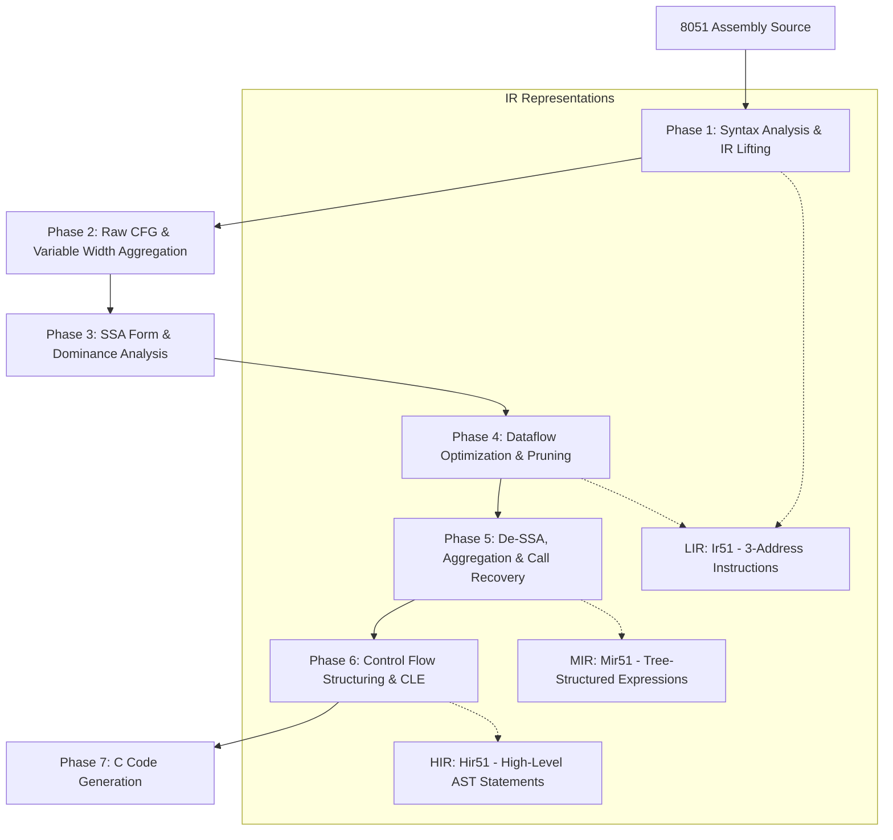

# Decom51: 8051 Machine Code Decompiler

Decom51 is a specialized, semantics-aware decompilation pipeline written in Rust. The primary goal of this decompiler is to translate raw 8051 assembly code back into high-level, human-readable, and idiomatic C code.

---

## 💡 Project Motivation & Design Philosophy

While general-purpose decompilers (such as Ghidra or Hex-Rays) are powerful, their reliance on generic, architecture-agnostic intermediate representations (like P-Code or microcode) often leads to verbose and obfuscated output when dealing with the unique architectural quirks of 8-bit microcontrollers like the Intel 8051:
- Explicit Carry/Borrow flag manipulation (`ADDC`, `SUBB`, `CJNE`, `JC`, `JNC`).
- Specialized banked registers mapped directly into internal RAM (`iData` addresses `0x00`-`0x1F`).
- Hardware SFRs (Special Function Registers) interacting directly with memory.
- Multi-byte variable operations synthesized across sequences of 8-bit instructions.

By building a specialized pipeline calibrated specifically for the 8051 architecture, Decom51 deeply understands the semantic intent behind instruction sequences. It combines classical compiler theory—such as **Static Single Assignment (SSA) Form**, **Sparse Conditional Constant Propagation (SCCP)** via **Lattice Theory**, and **Topological Graph Structuring**—with custom domain-specific recovery passes to eliminate low-level noise and reconstruct clean, idiomatic C code.

---

## 🏛️ Decompilation Pipeline Architecture

The pipeline processes input through three progressively higher-level intermediate representations before emitting final C code:



---

## 🧩 Multi-Tier Intermediate Representation (IR)

Decom51 uses a three-tier IR hierarchy to bridge the gap between machine instructions and high-level C abstractions:

1. **LIR (Low-Level IR - [`Ir51`](src/lir.rs))**:
   - Flat, 3-address code operating on physical registers, normalized internal memory addresses (`iData[0x..]`), temporaries, and SSA versions.
   - Operands: `Operand::Var(Addr, AddrSpace, Size)`, `Constant`, `Register`, `Temp`, `SSAVar`, `Local`.
2. **MIR (Mid-Level IR - [`Mir51`](src/mir.rs))**:
   - Structured instructions where expressions are aggregated into recursive trees ([`Expr`](src/mir.rs)), eliminating single-use temporaries.
3. **HIR (High-Level IR - [`Hir51`](src/hir.rs))**:
   - Block-structured AST containing high-level statements: `Assign`, `Call`, `Return`, `Loop`, `If`, and `Block`.

---

## 🔄 Detailed Pipeline Phases

### 🟢 Phase 1: Frontend & Lifting
Translates assembly text into normalized Low-Level IR (LIR).
- [x] **Lexical & Syntax Analysis ([`src/syntax/`](src/syntax/))**: Reads assembly files, tokenizing via [`lexer.rs`](src/syntax/lexer.rs) and constructing native 8051 AST nodes using [`parser.rs`](src/syntax/parser.rs).
- [x] **LIR Lifting ([`src/lifting/lifter.rs`](src/lifting/lifter.rs))**: Translates native 8051 AST instructions into flat LIR ([`Ir51`](src/lir.rs)).
- [x] **Memory Normalization ([`src/lifting/mem_normalizer.rs`](src/lifting/mem_normalizer.rs))**: Normalizes register operands (`R0`-`R7`, `A`, `B`, `SP`, `DPTR`, SFRs) into their physical memory addresses in internal RAM (`iData`), simplifying subsequent dataflow tracking.

---

### 🟡 Phase 2: Control Flow Construction & Variable Width Aggregation (VWA)
Builds the foundational graph topology and recovers multi-byte operations before SSA construction.
- [x] **CFG Reconstruction ([`src/opt/cfg_restorer.rs`](src/opt/cfg_restorer.rs))**: Identifies basic block leaders, partitions instructions into [`BasicBlock`](src/opt/cfg.rs) nodes, and resolves control-flow edges (successors and predecessors).
- [x] **Early Dead Block Elimination (DBE) ([`src/opt/dbe.rs`](src/opt/dbe.rs))**: Removes unreachable blocks before analysis passes.
- [ ] **Variable Width Aggregation (VWA) ([`src/opt/vwa.rs`](src/opt/vwa.rs)) (In progress)**: Fuses multi-byte operations (such as 16-bit `ADD` + `ADDC` sequences and multi-byte constant initializations) into multi-byte variables (`Operand::Var(addr, iData, 2)`), allowing SSA to version 16-bit variables seamlessly.

---

### 🟢 Phase 3: SSA Construction & Dominance Analysis
Transforms the CFG into Static Single Assignment (SSA) form.
- [x] **Dominance Analysis ([`src/opt/ssa/chk_algorithm.rs`](src/opt/ssa/chk_algorithm.rs))**: Computes immediate dominators, the Dominator Tree, and Dominance Frontiers using the Cooper-Harvey-Kennedy (CHK) algorithm.
- [x] **SSA Generation ([`src/opt/ssa/mod.rs`](src/opt/ssa/mod.rs))**: Algorithmically inserts Phi ($\Phi$) nodes at dominance frontiers and renames memory locations and temporaries into unique versions (`SSAVar` and `TempSSAVar`).

---

### 🟢 Phase 4: Dataflow Analysis & Optimization
Aggressively simplifies logic and removes dead code.
- [x] **Sparse Conditional Constant Propagation (SCCP) ([`src/opt/const_propagation.rs`](src/opt/const_propagation.rs))**: Computes constant values over a mathematical lattice (`Top`, `Constant`, `Bottom`), resolving math operations and static conditional branches.
- [x] **Rewriter & Constant Folding ([`src/opt/rewriter.rs`](src/opt/rewriter.rs))**: Replaces known SSA variables with literal constants, folds arithmetic operations, and turns dead branches into unconditional jumps.
- [x] **Dead Block Elimination (DBE) ([`src/opt/dbe.rs`](src/opt/dbe.rs))**: Prunes blocks made unreachable by constant condition resolution.
- [x] **Dead Code Elimination (DCE) ([`src/opt/dce.rs`](src/opt/dce.rs))**: Builds Def-Use chains to eliminate dead instructions and prune unused Phi functions.

---

### 🟢 Phase 5: SSA Destruction, Aggregation & Call Recovery
Bridges the gap between SSA form and structured expressions.
- [x] **De-SSA & Variable Coalescing ([`src/opt/dessa/`](src/opt/dessa/))**: Computes variable liveness ([`liveness.rs`](src/opt/dessa/liveness.rs)) and uses interference graphs/disjoint sets ([`dessa_mapping.rs`](src/opt/dessa/dessa_mapping.rs)) to coalesce non-interfering SSA versions into unified local variables (`Operand::Local`).
- [x] **Empty Block Elimination (EBE) ([`src/opt/ebe.rs`](src/opt/ebe.rs))**: Collapses empty jump/trampoline basic blocks, simplifying graph topology.
- [x] **Expression Aggregation ([`src/opt/expr_aggregation.rs`](src/opt/expr_aggregation.rs))**: Converts flat 3-address LIR statements into nested expression trees ([`mir::Expr`](src/mir.rs)), eliminating single-use temporaries (e.g., `t1 = a + b; t2 = t1 * c;` $\to$ `res = (a + b) * c;`).
- [x] **Call Recovery ([`src/opt/call_recovery.rs`](src/opt/call_recovery.rs))**: Matches stack adjustments (`PUSH`/`POP` / `*SP`) and argument registers to reconstruct high-level function calls and parameter passing ([`Mir51::Call`](src/mir.rs)).

---

### 🟡 Phase 6: Control Flow Structuring & High-Level Lifting
Reconstructs structured control flow syntax from the CFG topology.
- [x] **Loop Recovery ([`src/opt/loop_recovery/`](src/opt/loop_recovery.rs))**: Discovers backedges and loop headers to construct a nested hierarchy of loops ([`LoopTree`](src/opt/loop_recovery.rs)).
- [x] **Structured CFG & Loop Structuring ([`src/opt/structured_cfg.rs`](src/opt/structured_cfg.rs), [`src/opt/loop_structuring.rs`](src/opt/loop_structuring.rs))**: Encapsulates loop bodies into structured compound nodes and isolates loop condition evaluation.
- [x] **Control Logic Extraction (CLE) ([`src/opt/cle.rs`](src/opt/cle.rs))**: Traverses the structured graph, extracts basic branching, resolves convergence points, and lifts blocks into the High-Level IR ([`Hir51`](src/hir.rs)).
- [ ] **Condition Recovery (`if` / `else if` / `else`) (In progress)**: Resolves complex nested conditional branching and multi-way branch divergence into structured `if-else` blocks.

---

### 🟢 Phase 7: C Code Generation
Emits clean, formatted, and readable C source code.
- [x] **C Code Generation ([`src/codegen.rs`](src/codegen.rs))**: Traverses the `Hir51` AST, formats variable declarations, types (`unsigned char`, `unsigned short`/`int`), control flow blocks (`while`, `if`, `else`), function calls, and expressions into clean C source code.

---

## 🚀 Example Workflow with SDCC

Decom51 can be used alongside [SDCC (Small Device C Compiler)](https://sdcc.sourceforge.net/) and a disassembler (such as `dis51`) to test end-to-end decompilation of C programs.

> [!WARNING]
> **Current Scope & Limitations**:
> At the current stage of development, the decompiler parses and decompiles the **`main` function**, **variable declarations / assignments**, and **`while` loops**. Support for **`if-else` branching** is actively in progress.

### 1. Compile a C source file targeting the 8051
```bash
sdcc -mmcs51 input.c -o build/input.ihx
```

### 2. Disassemble the compiled binary to 8051 assembly
```bash
dis51 build/input.ihx > build/input.asm
```

### 3. Run Decom51 to decompile back to C
```bash
cargo run -- build/input.asm
```

The decompiler will parse the assembly, lift it through the multi-tier IR pipeline (LIR $\to$ MIR $\to$ HIR), and print the reconstructed, clean C code directly to standard output.
