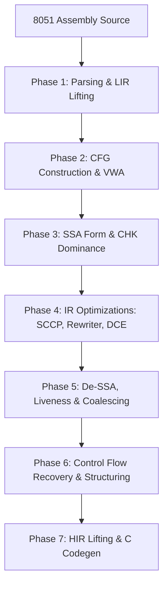

# Decom51: Intel 8051 Machine Code Decompiler

`decom51` (whose name originates from the companion disassembler [dis51](https://plit.de/asem-51/dis51.html)) is a specialized, semantics-aware decompiler written in Rust, designed to translate **Intel MCS-51 (8051)** assembly into clean, structured, and readable **C** source code.

---

## 📖 Overview & Limitations

The decompiler accepts disassembled 8051 assembly code and lifts it through a multi-tier intermediate representation (IR) pipeline into high-level C constructs, with a focus on multi-byte variable aggregation and structured control flow recovery.

> [!WARNING]
> **Some of the current limitations**:
> - **Memory Spaces**: Only internal RAM (`idata` / direct registers) is supported; external memory (`xdata`, `pdata`, `code`) is not yet handled.
> - **Register Banking**: Dynamic switching of register banks `R0`-`R7` via `PSW` (`RS0`/`RS1`) is not tracked.
> - **Variable Width Aggregation**: Calibrated for up to 16-bit variables (`unsigned int`); 32-bit types (`long`) or floats are not supported.
> - **SCCP Memory Tracking**: Unresolved memory loads are treated conservatively as `Unknown`.
> - **Scope**: Operates on an isolated `main` function body (without compiler runtime startup preambles and epilogues).
> - **Control Flow**: Supports structured `while` loops (including nested loops) and `if-else` conditional branching via post-dominance analysis; complex short-circuit operators (`&&`, `||`) and arbitrary unstructured jumps (`break`, `goto`) are not yet supported.
> - **External Disassembler**: Relies on assembly generated by an external disassembler ([dis51](https://plit.de/asem-51/dis51.html)).

---

## 💡 Motivations

The Intel 8051 architecture (introduced in 1980) remains widely deployed in automotive ECUs (e.g., Bosch Motronic), medical devices, and industrial controllers. As original C source code is frequently lost over decades of corporate transitions, reverse engineering is often necessary.

General-purpose decompilers (such as **Ghidra** or **IDA Pro**) produce obfuscated and verbose output for the 8051:
- They split 16-bit variables across disjoint 8-bit registers (e.g., `BANK1_R0` and `BANK1_R1`).
- They generate convoluted P-Code artifacts like redundant shifts and masks (e.g., `((bVar4 < BANK1_R0) << 7) >> 7`).
- They obscure control flow around hardware flags (`Carry`, `Borrow`).

`decom51` demonstrates that an architecture-tailored decompiler can synthesize these patterns into idiomatic, human-readable C code.

---

## ⚖️ Ghidra vs Decom51 Comparison

Targeting an identical 8051 binary compiled with SDCC containing a 16-bit integer loop (`for (unsigned int i = 65; i < 75; i++)`):

#### ❌ Ghidra Output (Register Splitting & P-Code Artifacts)
```c
while (cVar1 = ((bVar4 < BANK1_R2) << 7) >> 7, bVar5 < (byte)-cVar1) {
    BANK0_R6 = uVar2;
    BANK0_R7 = uVar3;
    FUN_CODE_00a8(bVar5 + cVar1, bVar4);
    bVar4 = bVar4 + 1;
    if (bVar4 == 0) {
        bVar5 = bVar5 + 1;
    }
}
```

#### ✅ Decom51 Output (Semantics-Aware Recovery)
```c
var1 = 65;
while ((var1 < 75)) {
    Block_8(var1);
    var1 = var1 + 1;
}
```

---

## 🏛️ Decompilation Pipeline Architecture

The pipeline processes input through three progressively higher-level intermediate representations:
- **LIR (`Ir51`)**: Flat 3-address instructions on normalized registers, physical memory addresses (`iData`), and temporaries.
- **MIR (`Mir51`)**: Expression-tree instructions ([`Expr`](src/mir.rs)) that collapse single-use temporaries.
- **HIR (`Hir51`)**: High-level block-structured AST containing typed declarations, structured `while` loops, `if-else` conditional branches, and function calls.



### Pipeline Phases

1. **Frontend & Memory Normalization**:
   - Tokenizes and parses 8051 assembly ([`src/syntax/lexer.rs`](src/syntax/lexer.rs), [`src/syntax/parser.rs`](src/syntax/parser.rs)).
   - Lifts instructions to LIR ([`src/lifting/lifter.rs`](src/lifting/lifter.rs)) and normalizes physical registers (`R0`-`R7`, `A`, `B`, `SP`, `DPTR`, SFRs) to internal RAM (`iData`) addresses ([`src/lifting/mem_normalizer.rs`](src/lifting/mem_normalizer.rs)).

2. **CFG Construction & Variable Width Aggregation (VWA)**:
   - Partitions instructions into basic blocks ([`src/opt/cfg.rs`](src/opt/cfg.rs)) and resolves jump edges ([`src/opt/cfg_restorer.rs`](src/opt/cfg_restorer.rs)).
   - Eliminates dead blocks (Early DBE: [`src/opt/dbe.rs`](src/opt/dbe.rs)).
   - Fuses paired 8-bit operations (`ADD` + `ADDC`, `SUBB`, carry-based comparisons) into 16-bit variables ([`src/opt/vwa.rs`](src/opt/vwa.rs)).

3. **SSA Form Construction**:
   - Computes immediate dominators and dominance frontiers via the **Cooper-Harvey-Kennedy (CHK)** algorithm ([`src/opt/ssa/chk_algorithm.rs`](src/opt/ssa/chk_algorithm.rs)).
   - Inserts $\phi$-nodes at convergence points and versions variables ([`src/opt/ssa/mod.rs`](src/opt/ssa/mod.rs)).

4. **Dataflow Optimizations**:
   - **Sparse Conditional Constant Propagation (SCCP)**: Solves constant propagation over a mathematical lattice ([`src/opt/const_propagation.rs`](src/opt/const_propagation.rs)).
   - **Rewriter & Constant Folding**: Replaces SSA variables with constants and evaluates constant expressions ([`src/opt/rewriter.rs`](src/opt/rewriter.rs)).
   - **Dead Code Elimination (DCE) & DBE**: Eliminates dead instructions and unreferenced $\phi$-nodes using Def-Use chains ([`src/opt/dce.rs`](src/opt/dce.rs), [`src/opt/dbe.rs`](src/opt/dbe.rs)).

5. **De-SSA & Variable Coalescing**:
   - Computes variable liveness intervals ([`src/opt/dessa/liveness.rs`](src/opt/dessa/liveness.rs)).
   - Builds interference graphs ([`src/opt/dessa/interference.rs`](src/opt/dessa/interference.rs)) and coalesces non-interfering variables ([`src/opt/dessa/coalescing.rs`](src/opt/dessa/coalescing.rs)).
   - Eliminates $\phi$-nodes ([`src/opt/dessa/phi_elimination.rs`](src/opt/dessa/phi_elimination.rs)) and prunes empty trampoline blocks (EBE: [`src/opt/ebe.rs`](src/opt/ebe.rs)).

6. **Control Flow Recovery & Structuring**:
   - **Loop Recovery**: Identifies natural loops and builds the loop nesting tree ([`src/opt/loop_recovery.rs`](src/opt/loop_recovery.rs)).
   - **Structured CFG & Loop Structuring**: Encloses loop bodies into structured `While` nodes ([`src/opt/structured_cfg.rs`](src/opt/structured_cfg.rs), [`src/opt/loop_structuring.rs`](src/opt/loop_structuring.rs)).
   - **Condition Structuring**: Recovers `if-else` conditional branches via post-dominance analysis ([`src/opt/cond_structuring.rs`](src/opt/cond_structuring.rs)).
   - **Expression Aggregation**: Fuses 3-address instructions into nested MIR expression trees ([`src/opt/expr_aggregation.rs`](src/opt/expr_aggregation.rs)).
   - **Call Recovery**: Recovers function calls and actual arguments ([`src/opt/call_recovery.rs`](src/opt/call_recovery.rs)).

7. **High IR & C Codegen**:
   - Lifts the structured representation to HIR ([`src/hir.rs`](src/hir.rs)) and emits clean C source code ([`src/codegen/mod.rs`](src/codegen/mod.rs)).

---

## 🛠️ Usage with [dis51](https://plit.de/asem-51/dis51.html)

### Prerequisites
- **Rust Toolchain** (edition 2021): install via [rustup](https://rustup.rs/) or directly via your distribution's package manager:
  - Arch Linux: `sudo pacman -S rust`
  - Fedora / RHEL: `sudo dnf install cargo rust`
  - Debian / Ubuntu: `sudo apt install cargo rustc`
- **SDCC** ([Small Device C Compiler](https://sdcc.sourceforge.net/)):
  - Arch Linux: `sudo pacman -S sdcc`
  - Fedora / RHEL: `sudo dnf install sdcc` *(note: on Fedora, the command is `sdcc-sdcc`, not just `sdcc`)*
  - Debian / Ubuntu: `sudo apt install sdcc`
- **[dis51](https://plit.de/asem-51/dis51.html)**: compile using the included `Makefile` (run `make` inside the `dis51` directory) and ensure the `dis51` binary is in your `PATH`.

The end-to-end workflow for compiling, disassembling with [dis51](https://plit.de/asem-51/dis51.html), and decompiling an 8051 program:

### 1. Compile C source with SDCC
```bash
sdcc -mmcs51 main.c -o main.ihx
# Note: On Fedora, use `sdcc-sdcc -mmcs51 main.c -o main.ihx`
```

### 2. Disassemble with [dis51](https://plit.de/asem-51/dis51.html)
```bash
cat main.ihx | dis51 > main.raw.asm
```

### 3. Isolate the `main` function body
Extract the `main` function block (typically from entry label `L0005:` through `END`) into `main.asm`:
```assembly
L0005:
    MOV  008h,#000h
    MOV  009h,#000h
    ...
    RET
    END
```

### 4. Decompile with decom51
```bash
cargo run -- main.asm
```

Or using the release binary:
```bash
cargo build --release
./target/release/decom51 main.asm
```

Output:
```c
Codegen:
unsigned char var1 = 0;
while ((var1 < 10)) {
    var1 = var1 + 1;
}
while (1) {
}
```

---

## 🎓 Academic Context

`decom51` was developed as a Bachelor's Degree thesis project in Computer Science. The theoretical formulation, intermediate representation formalizations, and architectural evaluations are documented in the companion thesis repository: **[thesis51](https://github.com/FomalhautGH/thesis51)**.
